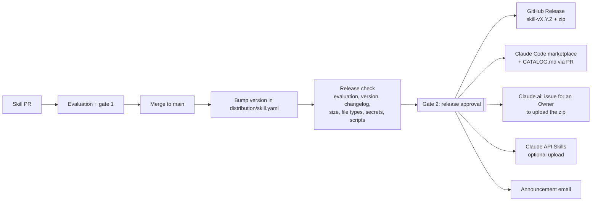

# Skill distribution

How an evaluated skill reaches people, and how it is updated, deprecated and retired.

## Strategy

**One repo, one source of truth, two gates.** Skills, their evaluations and their releases all live in
this repo. A skill reaches users only after two separate human approvals:

| Gate | Question | Who | Where |
|---|---|---|---|
| 1. Evaluation approval | Is this version good, and still useful? | Skill owner / tech lead | `skill-eval-approval` environment |
| 2. Release approval | Should this exact version go out, to whom, through which channels? | AI governance group | `skill-release-approval` environment |

The release check refuses anything that has not passed gate 1 **for the exact same content**, so editing
a skill after evaluation means re-evaluating it.



### Channels

| Channel | How users get it | What the pipeline does | Automatic? |
|---|---|---|---|
| **Claude Code** | `/plugin marketplace add <org>/<repo>` once, then `/plugin install <skill>@<marketplace>`. IT can add the marketplace and enable skills for everyone with managed settings (`distribution/claude-code-settings.json`) | Writes a frozen copy of the released version to `marketplace/plugins/<skill>/` and lists it in `.claude-plugin/marketplace.json` | Yes, on merge of the release PR |
| **Claude.ai** (Team / Enterprise) | Owner-provisioned skills are switched on for everyone (users can turn individual ones off) | Builds the zip Claude.ai accepts, attaches it to the GitHub Release, and opens an issue assigned to the Claude.ai Owner with the steps | Semi: Claude.ai has no provisioning API, so an Owner uploads the zip in Organization settings > Plugins & skills, then runs *confirm-claude-ai* |
| **Claude API** | Agents and apps reference the skill id | Uploads the zip to the Skills API (new skill first time, new version afterwards) and records the skill id | Yes, when the skill lists `api` and the run ticks *upload_api* (needs `SKILLS_API_KEY`) |

Only **released** versions are distributed. The marketplace serves the frozen copy from the release, not
whatever is on `main`, so work in progress never reaches users.

### Lifecycle

```
draft (no manifest / not released) -> active (released) -> deprecated (still installable, marked, replacement named)
                                                         -> retired (removed from the marketplace; Owner removes it from Claude.ai)
```

- **New version:** bump `version` (semver) and add a `changelog` entry in `distribution/<skill>.yaml`.
- **Deprecate:** Actions > Skill release > action *deprecate*, with a reason and the replacement. The plugin
  description starts with `[DEPRECATED - use X]` and the catalog says so.
- **Retire:** action *retire*. The skill leaves the marketplace (set `remove_retired_from_users: true` to
  also uninstall it from users' Claude Code) and an issue asks the Owner to remove it from Claude.ai.
- **Reactivate:** action *reactivate* restores the last released version if the skill is unchanged.
- The daily evaluation scheduler already flags skills whose verdict drops to RETIRE CANDIDATE or HARMFUL -
  that is the signal to deprecate or retire.

### Release check (code-enforced, shown to the release reviewer)

| Check | Blocks |
|---|---|
| Approved evaluation exists for the exact current content | yes |
| That evaluation passed the automated gate, was human-reviewed, is younger than `max_evaluation_age_days` | yes |
| Usefulness verdict not in `block_verdicts` (default HARMFUL); `warn_verdicts` (RETIRE CANDIDATE) warn | yes / warn |
| Version is semver and higher than the last release; changelog entry for it | yes |
| `SKILL.md` name equals the folder name; owner set; channels known | yes |
| Package size limit, forbidden file types (.exe, .dll, ...), secret patterns (API keys, private keys, passwords) | yes |
| Scripts Claude may run, external URLs, unchanged content (metadata-only release) | warn |

## Files

```
distribution.yaml                       org settings: marketplace name, channels, release policy, notifications
distribution/<skill>.yaml               release manifest per skill - the only file people edit to release
distribution/claude-code-settings.json  generated managed-settings snippet (marketplace + enabled skills)
releases/<skill>/<version>.json         one record per release: who, when, checksum, evaluation, channels
marketplace/plugins/<skill>/            generated: frozen released copy as a Claude Code plugin
.claude-plugin/marketplace.json         generated: the Claude Code marketplace
CATALOG.md                              generated: what is released, status, owner, how to install
skilldist/                              the release tooling (python -m skilldist ...)
.github/workflows/skill-release.yml     the release workflow with the release approval gate
```

Example `distribution/pii-redactor.yaml`:

```yaml
version: 1.1.0
status: active               # active | deprecated | retired
owner: data-protection-team
category: Security & Compliance
tags: [pii, privacy]
channels: [claude_code, claude_ai]   # add api to publish to the Claude API
audience: all                # or Claude.ai groups, e.g. [finance, legal] (Enterprise group targeting)
replaced_by: null
changelog:
  1.1.0: Masks UK National Insurance numbers.
  1.0.0: First release.
```

## One-time setup

1. **Release approval:** Settings > Environments > New environment `skill-release-approval` > Required
   reviewers = the governance group (ideally not the same people as the evaluation reviewers) > untick
   "Allow administrators to bypass" > Save.
2. **`distribution.yaml`:** set `marketplace.name` (e.g. `victaulic-skills` - not a `claude-*` or
   `anthropic-*` name), `owner`, `notify.claude_ai_admins` (GitHub users who upload to Claude.ai) and
   `notify.announce_emails`.
3. **Claude.ai policy** (an Owner): Organization settings > Plugins & skills > Policy: *Skills* and *Cloud code
   execution and file creation* on. Consider switching *User-created skills* off so only released skills are
   used.
4. **Claude Code for everyone** (IT, optional): put the content of `distribution/claude-code-settings.json`
   into Claude Code managed settings. Users then get the marketplace and the released skills automatically.
   Org members need read access to this repo.
5. **Claude API channel** (optional): secret `SKILLS_API_KEY`, `channels.api: true` in `distribution.yaml`.
6. **Merge protection:** the existing *Skill approval check* now also runs `python -m skilldist lint`.

## Day to day

**Release a skill**
1. The skill's evaluation is approved and merged (as today).
2. In a PR, bump `version` in `distribution/<skill>.yaml` and add the changelog line. Merge.
3. *Skill release* starts by itself, shows the readiness check, and waits for the release reviewer:
   **Review deployments > skill-release-approval > Approve**.
4. It then creates the GitHub Release (`<skill>-v<version>` with the zip), opens the release PR (merge it -
   the marketplace and catalog update), opens the Claude.ai upload issue, and emails the announcement.
5. The Claude.ai Owner uploads the zip, runs *Skill release > confirm-claude-ai*, and closes the issue.

You can also start it by hand: Actions > Skill release > Run workflow > skill (or *pending*) > *release*.

**Locally**
```bash
python -m skilldist pending                       # skills with an unreleased version
python -m skilldist check --skill pii-redactor    # readiness report
python -m skilldist package --skill pii-redactor  # dist/pii-redactor-1.1.0.zip
claude plugin validate .                          # validate the generated marketplace
```
